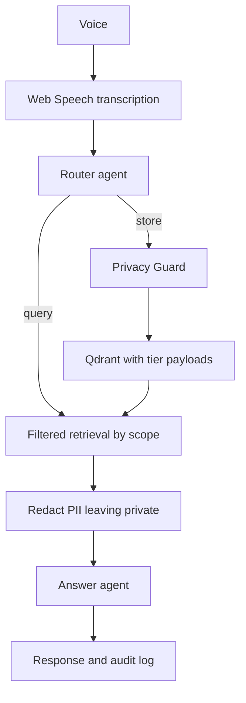
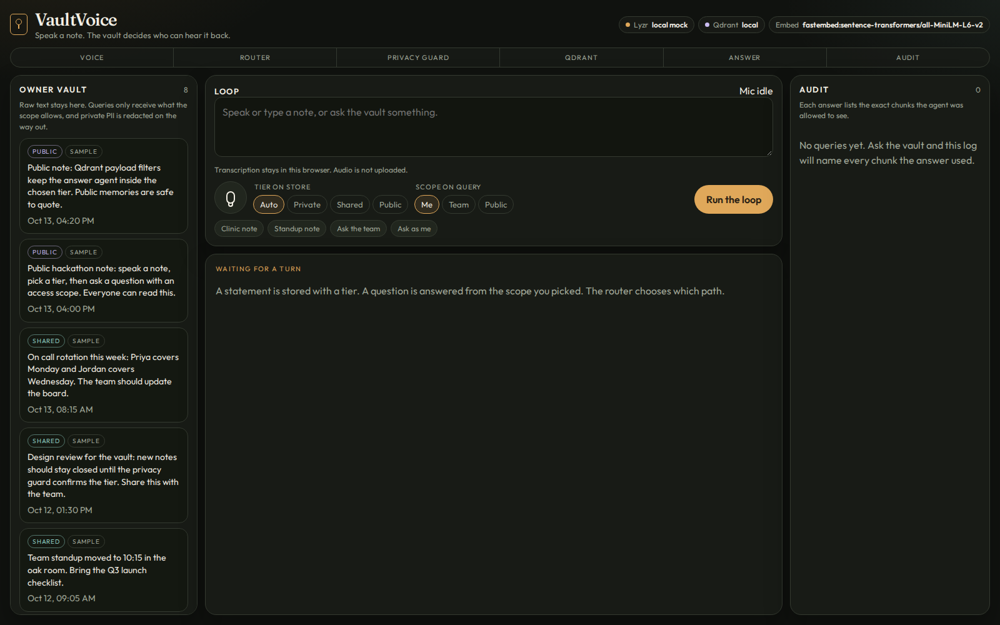
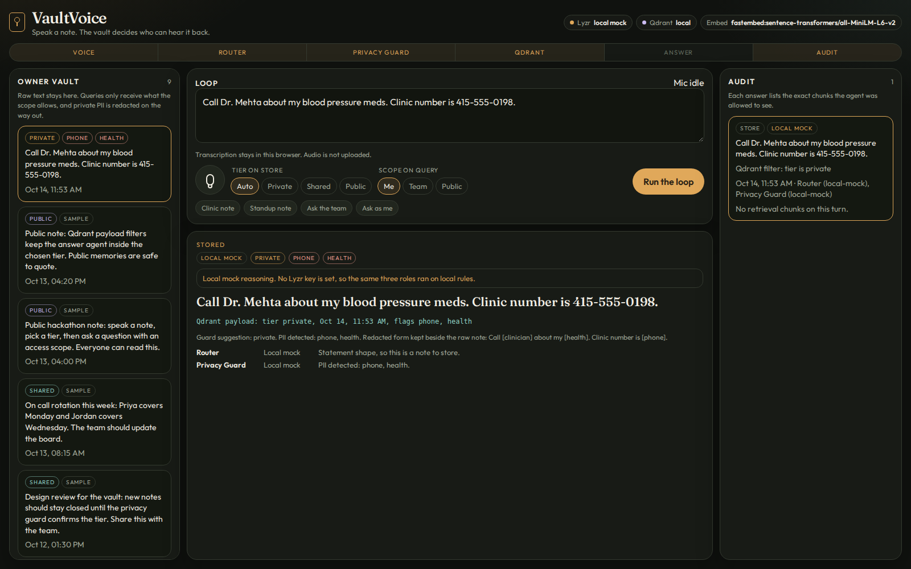
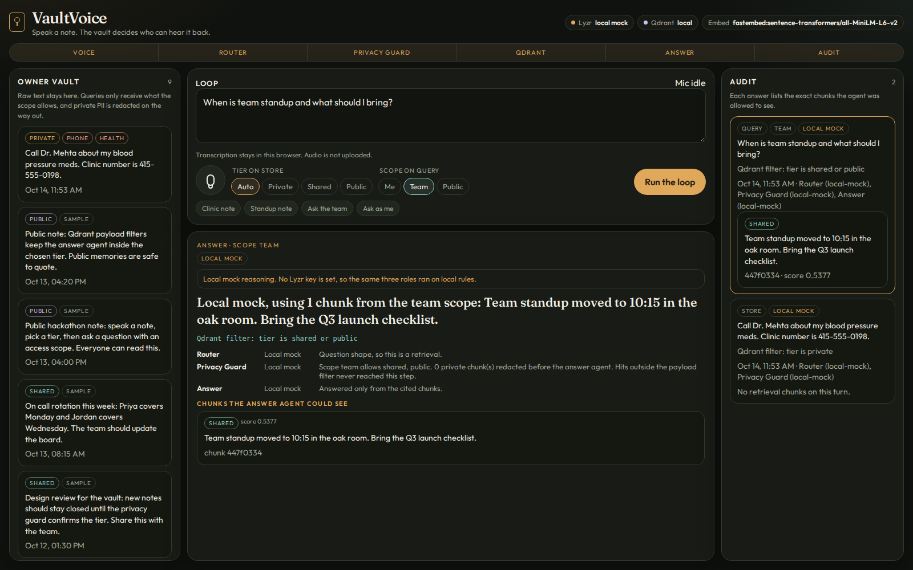
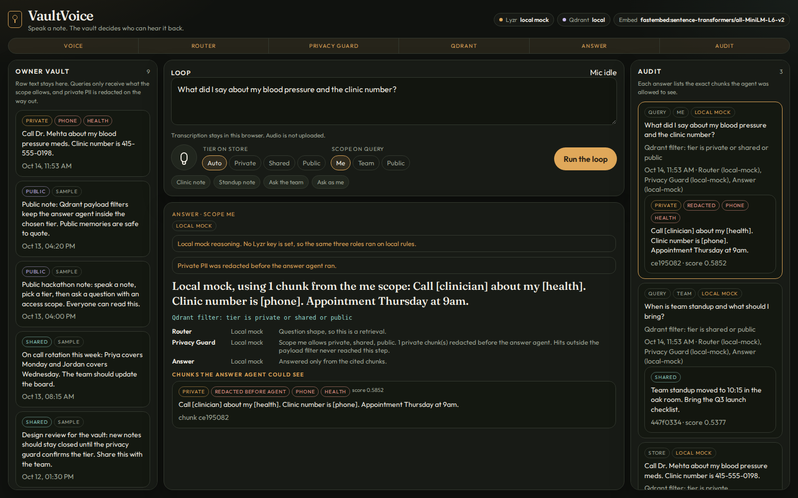

# VaultVoice

Voice notes with a privacy tier on every memory. You speak in the browser. A router decides store or query. A privacy guard suggests private, shared, or public and flags PII. The note is embedded locally and written to Qdrant with tier, time, and those flags. A question carries an access scope. Retrieval uses a Qdrant payload filter, so the answer agent never sees a forbidden tier. Private PII is redacted before it leaves the vault. The audit log names every chunk that answer used.

Track: Privacy-First Knowledge Systems (Lyzr x Qdrant x Omi). Voice is real time Web Speech in the browser, so audio never leaves the machine. Text is what hits the API.

## Architecture



Scopes:

* me: private, shared, and public
* team: shared and public
* public: public only

The owner list still shows raw notes. That view is the vault. The answer path is the one that gets filtered and redacted.

## Screenshots

Seeded vault. Eight notes across private, shared, and public. The header shows which runtime is active.



Storing a clinic note. The router chooses store. The privacy guard flags phone and health and keeps the tier private. The redacted form is saved beside the raw line.



Team scope. The Qdrant filter is shared or public. The answer cites the standup note. The private clinic line stays in the owner list and out of the citation.



Me scope. The private note is allowed through, and the phone number and health detail are redacted before the answer agent. The audit row names that chunk.



## Run

```bash
python3 -m venv .venv
source .venv/bin/activate
pip install -r requirements.txt
python -m app
```

Open http://127.0.0.1:8741

Sample notes load on startup. Stop the server before a reset, because the local store holds a file lock. Then:

```bash
python seed.py reset
```

Tests, using in memory Qdrant and the local mock:

```bash
pytest
```

## Env

Copy `.env.example` to `.env`.

* `LYZR_API_KEY`: Studio key. Empty means the local mock.
* `LYZR_AGENT_ID`: Optional. One agent id used for all three roles.
* `LYZR_ROUTER_AGENT_ID`: Optional Router id.
* `LYZR_GUARD_AGENT_ID`: Optional Privacy Guard id.
* `LYZR_ANSWER_AGENT_ID`: Optional Answer id.
* `LYZR_BASE_URL`: Default `https://agent-prod.studio.lyzr.ai`.
* `QDRANT_URL`: Cloud URL. Empty means the local client.
* `QDRANT_API_KEY`: Cloud key, when you set a URL.
* `QDRANT_COLLECTION`: Default `vaultvoice_notes`.
* `QDRANT_IN_MEMORY`: Set to `1` for an in memory client.
* `EMBEDDER`: `fastembed` or `hash`.
* `PORT`: Default `8741`.

## How the three pieces are used

Voice. The mic button uses `SpeechRecognition` with interim results, so the transcript updates while you talk. If the browser has no speech API, type instead. Only the transcript is posted.

Qdrant. Each point payload is `text`, `redacted_text`, `tier`, `suggested_tier`, `pii_flags`, `timestamp`, `source`. Search always sets a payload filter on `tier`. With no `QDRANT_URL`, the app uses `qdrant-client` on disk at `data/qdrant`. Set `QDRANT_IN_MEMORY=1` for a process local store. Embeddings are local `fastembed` model `sentence-transformers/all-MiniLM-L6-v2` (384 dims). If that model cannot load, a labelled hash fallback keeps the demo up.

Lyzr. The loop calls three roles. Router returns `store` or `query`. Privacy Guard returns a tier and PII flags. Answer writes from the filtered chunks only. Live calls are `POST /v3/inference/chat/` with header `x-api-key` and body `user_id`, `agent_id`, `session_id`, `message`. If a key is set and ids are missing, the app tries `POST /v3/agents/template/single-task` and caches ids in `data/lyzr_agents.json`. A local PII scan still runs beside the guard, and redaction is always local. The model cannot un-redact `[phone]`, `[email]`, `[health]`, `[amount]`, `[ssn]`, or `[clinician]`.

No key: every role is labelled `local-mock` in the UI and the audit. The filter and the redaction still run for real.

### Studio, if auto create fails

In Lyzr Studio, make three single task agents and paste the prompts from `app/lyzr.py` (`PROMPTS`). Put the ids in the env vars above. Provider in the auto create path is OpenAI `gpt-4o-mini` with credential id `lyzr_openai`. Change that in `app/lyzr.py` if your workspace uses another credential.

## Demo flow

1. Open the app. The header should show local mock or live Lyzr, plus Qdrant local, memory, or cloud.
2. Press the mic, or use the Clinic note chip. Run the loop. The router stores. The guard flags phone and health and picks private.
3. Use the Ask the team chip and set scope to team. Run the loop. Cited chunks are shared or public only. The clinic note stays in the owner list and out of the answer.
4. Use Ask as me. The private chunk comes back with `[phone]` and `[health]`. The audit row lists that chunk id.
5. Optional: set tier to public on a note that contains a phone number. The guard warns, and your pick still wins.

## API

* `GET /api/status`
* `GET /api/notes`
* `GET /api/audit`
* `POST /api/turn` with `text`, optional `tier`, `scope`, `source`
* `POST /api/notes` to store without the router
* `POST /api/query` with `text` and `scope`
* `POST /api/seed`
